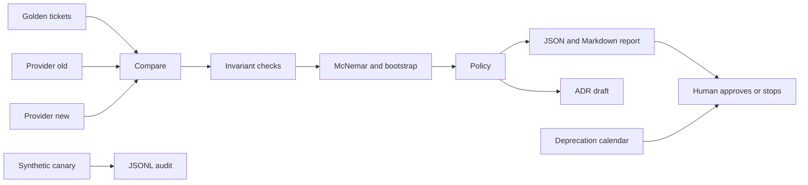

# model-migration-eval-kit

[](https://github.com/dlescanogithub/model-migration-eval-kit/actions/workflows/ci.yml)

Offline check for a fictional shop, Casa Brisa: same 63 synthetic tickets, two scripted providers, a go/no-go. It does not call a paid model and it does not move production traffic.

## Problem and result

Swapping a model because the new one is cheaper can hide a bad slice. This repo runs one golden set on an old and a new provider and refuses the swap when a configured slice drops too far, when the adversarial slice gets worse, or when a paired test says the extra failures are not a coin flip.

Measured on 2026-10-17, package 0.2.2, Python 3.12.3. Command:

```text
python -m migration_eval compare --old fake-old --new fake-new --runs 10 --today 2026-10-17
```

The edge slice pass rate goes from 1.0000 to 0.6667, a drop of 33.33 points on n=21 tickets. The policy cap is 5 points, so the decision is **NO_GO**. That NO_GO is built into `fake-new` on purpose. It shows the gate fires. It is not a difference between two real models. Expected labels come from the same spec as the fakes, so the rates show that the machinery runs. The full table is [docs/example-report.md](docs/example-report.md). Latency in that run is simulated. Prices in that run are [EST] figures from [config/prices.yaml](config/prices.yaml), not a vendor invoice.

## Demo

One command, no API key, cost zero:

```text
python -m migration_eval compare --old fake-old --new fake-new --runs 10 --today 2026-10-17 --out out/demo
```

`make demo` runs the same command. It writes `out/demo/report.md`, `out/demo/report.json`, and `out/demo/migration-adr.md`.

### How to decide in hours

1. Freeze the task (here: category, priority, queue for a Casa Brisa ticket).
2. Freeze the golden set and the invariants, not a target sentence.
3. Run old and new on the same tickets. Collapse seed repeats per ticket before any test. The unit of analysis is the ticket.
4. Read the slice table, the harmful-effect count, the cost delta, and the p95.
5. Apply the policy in [config/policy.yaml](config/policy.yaml). Accept only GO, NO_GO, or NEED_HUMAN.
6. If the decision is GO, a named human still has to approve. This tool does not approve.
7. Rehearse rollback on the synthetic canary before anyone talks about live traffic.
8. If a cutoff date is close, run the calendar check with an injected today.

## Business case

The simulated bill for one pass of the golden set falls from 0.069515 USD to 0.014914 USD (savings ratio 0.7855) under the [EST] price table, and the edge slice still fails the gate. A cheaper model that misses the hard tickets is not a migration. The ROI sketch, the cost of missing the illustrative cutoff, and the stakeholder note are in [docs/BUSINESS_CASE.md](docs/BUSINESS_CASE.md). Those business figures are [EST]. The only measured money-shaped numbers are the simulated costs in the report above.

## Architecture



Detail: [docs/architecture.md](docs/architecture.md).

## Platform migrations

The second axis is the platform, after the model. Inventory, waves, parity, cutover, and registry rollback run on a fictional analytics group, Aerolito Data. The chapter is [docs/platform-migrations/README.md](docs/platform-migrations/README.md). The command is `python -m migration_eval platform-migrations`. The money illustration in that chapter is negative and uses fictional inputs. It is not a client invoice.

Measured on 2026-10-17, package 0.2.0, Python 3.12.3: `platform-migrations eval` exited 0 with 12/12 invariants, and `platform-migrations eval-regression` exited 1 with verdict FAIL and `gate_went_red` true. `platform-migrations demo` on the Aerolito fixtures reported 6 waves, parity PASS, gate READY, and a simulated dual-run cost of 280 from the [EST] inputs in [docs/platform-migrations/COST.md](docs/platform-migrations/COST.md).

## Results

Measured 2026-10-17, package 0.2.2, Python 3.12.3, command in the Problem section, 10 seed repeats collapsed to n=63 tickets. Re-run on this package matched the committed report. Source file: [docs/example-report.md](docs/example-report.md). Contract mismatch tickets are 0 and 1. The one ticket is the scripted invalid JSON in `fake-new`. It is not a harmful ticket. On that same offline run, priority_ok is 63 on fake-old and 58 on fake-new. It is counted separately from the overall pass rate. The fakes do not read the live prompt.

| Slice | n | Old pass rate | New pass rate | Drop (points) | Bootstrap 95% (new - old) |
| --- | ---: | ---: | ---: | ---: | --- |
| happy | 28 | 1.0000 | 0.9643 | 3.57 | [-0.1071, 0.0000] |
| edge | 21 | 1.0000 | 0.6667 | 33.33 | [-0.5238, -0.1429] |
| adversarial | 14 | 1.0000 | 1.0000 | 0.00 | [0.0000, 0.0000] |
| overall | 63 | 1.0000 | 0.8730 | 12.70 | [-0.2222, -0.0476] |

| | fake-old | fake-new |
| --- | ---: | ---: |
| Cost per run, USD, simulated, prices [EST] | 0.069515 | 0.014914 |
| p50 latency ms, simulated | 440.0 | 196.0 |
| p95 latency ms, simulated | 459.0 | 209.0 |
| Harmful tickets | 0 | 0 |

Decision: **NO_GO**, because the edge slice drops 33.33 points on 21 tickets (cap 5). The paired test uses those 63 tickets, not 63 times the 10 seeds. Eight tickets fail only on `fake-new`. Seeds change simulated latency and are collapsed before the test, so adding repeats does not change the p-value or the intervals above. The scripted gap is there to exercise the gate.

Other profiles, same command shape, `--runs 10 --today 2026-10-17`, measured in the same session:

| New provider | Decision | Overall pass rate | Notes |
| --- | --- | ---: | --- |
| fake-new-close | GO | 1.0000 | Same labels as fake-old, lower [EST] price |
| fake-new-flat | NEED_HUMAN | 1.0000 | Same labels, savings ratio 0.0000 |
| fake-new-degraded | NO_GO | 0.6667 | Adversarial pass rate 0 on n=14, 14 harmful tickets |

### Live compare

The first live run was on 2026-10-17: `python -m migration_eval compare-live --runs 1`, 63 tickets, the same model on both sides. It was a self-compare, not a migration. It stays **historical**: priority passed 37/63 (58.7%) because the priority rules were not in the prompt. That is corrected.

The contract on that historical run was fine: 63/63 on schema, category, queue, and one `route_ticket`; injection 63/63; harmful 0/63. The 26 failures were priority only: shipping 7, payment 7, complaint 6, order_status 3, return_request 3. The prompt only said `priority: one of low, medium, high`. The grader rules were not in the prompt. This change generates them from the same table the grader uses (`PRIORITY_RULES` in `spec.py`).

The later run, the same day, `compare-live --runs 1`, model `grok-4.20-0309-non-reasoning`, was a self-compare (the same model on both sides) and an independent check after the fix. Pass 55/63 on old and 56/63 on new. `priority_ok` 56 and 57. Real cost about US$0.053 per run. The repo estimate, about US$0.100, ignores cached tokens.

That run is a self-compare, not a migration. Differences between old and new are sampling noise (29/63 raw responses were identical; the rest differed by model variation). It is not evidence of improvement or of regression. McNemar or GO/NO_GO on a self-compare is not evidence of anything.

The cost this repo computes is input tokens and output tokens times the environment rate. It ignores cached tokens, so it overestimates when the provider discounts the cache. On the historical 2026-10-17 run the estimate was about US$0.100 and the real cost was US$0.053.

| Date | Command | Sides | What was measured | n | Notes |
| --- | --- | --- | --- | ---: | --- |
| 2026-10-17 | `compare-live --runs 1` | same model both sides | HISTORICAL priority 37/63 (58.7%); contract 63/63; harmful 0/63 | 63 | Historical. Priority rules were absent from the prompt. Corrected. Self-compare, not a migration. Real cost US$0.053; estimate ~US$0.100 because cached tokens are ignored. |
| 2026-10-17 | `compare-live --runs 1` | `grok-4.20-0309-non-reasoning` both sides | pass 55/63 old, 56/63 new; priority_ok 56 and 57 | 63 | Independent verification after the fix. Auto-compare, not a migration. 29/63 raw responses identical; the rest differed by model variation. Not evidence of improvement or regression. Real cost ~US$0.053 per run; repo estimate ~US$0.100 ignores cached tokens. |

The reference gate `python -m migration_eval eval --provider fake-old --runs 5 --today 2026-10-17` printed `pass_rate=1.0000`, `harmful=0`, `cost_per_run=0.069515`, `p95_ms=459.0`, `ok=true`.

## Use cases, governance and business strategy

### 1. Use cases

Client-style cases use the fictional shop Casa Brisa or a described pattern. They are not a real client.

| Use case | Status | Problem | Who approves | Gated effects | How this repo handles it |
| --- | --- | --- | --- | --- | --- |
| Ticket triage model migration for Casa Brisa | Implemented | A cheaper model may mis-prioritise edge tickets or obey text inside the ticket | A human. The tool only recommends GO, NO_GO, or NEED_HUMAN | Category, priority, queue, and the only allowed tool `route_ticket`. No email, no refund, no external send | Golden set, invariant checks, comparison report, policy, synthetic canary, deprecation calendar |
| Platform move for Aerolito Data (fictional) | Implemented as a local rehearsal | A cutover without lineage or parity can ship a silent table change, or leave two scores live | A human. The gate returns READY, NOT_READY, or NEED_HUMAN and does not flip an application flag | Wave order, parity verdict, registry copy, rollback snapshot. No catalog write and no scheduler change | Manifest scan, wave planner, parity checker, registry simulator, checklist gate. See [docs/platform-migrations/README.md](docs/platform-migrations/README.md) |
| Document-extraction model swap | Design only | A new model may drop fields or invent values on scanned forms | A human reviewer per batch, plus the same policy owner | Writes into a store of extracted fields. No payment and no customer message | Not built. The same report shape would score field presence and "no invented id", not exact strings |
| Voice-agent LLM swap | Design only | A cheaper model may skip a required disclosure or transfer to the wrong queue | A human who owns the call flow | Spoken reply and transfer target. No account change during the trial | Not built. Would need audio fixtures and a disclosure invariant. See the design note in docs/SCOPE.md |

| Use case | Status | Problem | Who approves | Gated effects | How this repo handles it |
| --- | --- | --- | --- | --- | --- |
| Personal assistant model switch when a cheaper model appears | Design only | The cheap model may send a message or change a calendar item the person did not confirm | The person, on each external action | Messages and calendar writes stay off until confirmed | Not built. The policy idea is the same: NO_GO if a harmful action appears |
| Newsletter summariser model comparison | Design only | A summary may drop a correction or follow an instruction hidden in the mail | The person who publishes | Draft text only. No send | Not built. A golden set of synthetic mails would score "correction kept" and "injection ignored" |

### 2. Governance checklist

| Control | Where it lives |
| --- | --- |
| Allowed categories, priority rules, allowed queue, allowed tool | [src/migration_eval/spec.py](src/migration_eval/spec.py) is the table. The live prompt's priority lines and category-to-queue lines are generated from it. [src/migration_eval/invariants.py](src/migration_eval/invariants.py) scores the result |
| Human approval | The decision GO is a recommendation. [src/migration_eval/adr.py](src/migration_eval/adr.py) writes a draft ADR and does not apply it |
| Traceability | JSONL trace summary from `compare`, canary audit JSONL from [src/migration_eval/canary.py](src/migration_eval/canary.py) |
| Risks | [docs/RISKS.md](docs/RISKS.md) |
| Costs | [docs/COST.md](docs/COST.md) and [config/prices.yaml](config/prices.yaml) |
| Incident and rollback | [docs/RUNBOOK.md](docs/RUNBOOK.md), synthetic rollback in the canary |
| Forced red gate | `make eval-regression` must exit non-zero. CI asserts that |
| Secret scan | [src/migration_eval/secretscan.py](src/migration_eval/secretscan.py), CI job `Secret scan` |
| Live provider off | [src/migration_eval/providers/openai_compat.py](src/migration_eval/providers/openai_compat.py). `LIVE_MODE` defaults to off. CI does not set it |
| Platform wave order, parity, and registry rollback | [docs/platform-migrations/](docs/platform-migrations/). `platform-migrations eval-regression` must exit non-zero. CI asserts that |
| Platform real provider off | `MLMIG_PROVIDER` defaults to `fake`. `real` and cassette recording raise before any socket |

Not covered yet:

- Real traffic mirroring or shadowing
- A live canary on real traffic
- Contract or legal review with a provider
- Identity, access reviews, and production on-call paging
- A human-labelled set that was not generated by the same spec the fakes use

### 3. Business strategy

The business problem is a cutoff or a price change on a model that already triages tickets. Moving late means a scramble. Moving early, on price alone, means a quiet quality miss. The ROI model is [EST] and written out in [docs/BUSINESS_CASE.md](docs/BUSINESS_CASE.md). Scope and phases are in [docs/SCOPE.md](docs/SCOPE.md). Success metrics are in [docs/METRICS.md](docs/METRICS.md).

Deployment Strategist conversation: start with discovery ([docs/DISCOVERY.md](docs/DISCOVERY.md)), not with a model name. Run the old and new systems on the same frozen set while both are still available (shadow, then a gate). The harness owner owns the golden set, the thresholds, and the report. The support lead owns the label rules. A named human owns the GO. Finance owns the cutoff date. Nobody in this repo owns a production router, because there isn't one.

## Decisions

- [docs/adr/0001-offline-harness.md](docs/adr/0001-offline-harness.md)
- [docs/adr/0002-invariants-not-trajectories.md](docs/adr/0002-invariants-not-trajectories.md)
- [docs/adr/0003-provider-abstraction.md](docs/adr/0003-provider-abstraction.md)
- [docs/adr/0004-go-nogo-policy.md](docs/adr/0004-go-nogo-policy.md)

A filled migration ADR for the measured NO_GO is [docs/example-migration-adr.md](docs/example-migration-adr.md).

## Security and known limits

See [SECURITY.md](SECURITY.md) and [docs/RISKS.md](docs/RISKS.md).

### What this does NOT do

- It does not call a paid API in CI or in the default commands.
- It does not mirror live traffic or run a live canary.
- It does not approve a migration. GO still needs a human.
- It does not execute `route_ticket`. The tool call is a field on a JSON object.
- It does not prove a real model. `fake-old` and `fake-new` are scripted simulators, and their labels come from the same spec.
- It does not review a vendor contract.
- It does not use client data. Every ticket is synthetic.

### Design-only vs implemented

| Piece | Status |
| --- | --- |
| Golden set, invariants, fake providers, cassette, comparison, policy, report, ADR draft | Implemented |
| Synthetic canary and rollback decision, deprecation calendar | Implemented |
| Forced regression (`fake-new-degraded` must be NO_GO) | Implemented |
| Optional chat-completions HTTP adapter (`compare-live`), off unless `LIVE_MODE=1` | Implemented. Historical self-compare 2026-10-17: priority 37/63 (58.7%), rules absent from the prompt, corrected. Later the same day, `compare-live --runs 1`, `grok-4.20-0309-non-reasoning` both sides: pass 55/63 and 56/63, priority_ok 56 and 57. Auto-compare, not evidence of a migration. Not used in CI |
| Live shadow, live canary, contract review | Design only |
| Document-extraction swap, voice-agent swap, personal assistant, newsletter | Design only |
| Platform inventory, waves, parity, checklist gate, registry simulator, 12 invariants, forced parity regression | Implemented, synthetic files only |
| Platform catalog write, scheduler cutover, table restore on a lakehouse | Design only |

## How to reproduce

Cost of the default path: zero. No key, no network call to a model vendor.

```text
python -m pip install -e ".[dev]"
python -m ruff check .
python -m ruff format --check .
python -m mypy
python -m pytest
python -m migration_eval eval --provider fake-old --runs 5 --today 2026-10-17
python -m migration_eval compare --old fake-old --new fake-new --runs 10 --today 2026-10-17 --out out/demo
python -m migration_eval canary --old fake-old --new fake-new --today 2026-10-17 --out out/canary-audit.jsonl
python -m migration_eval deprecation-check --today 2026-10-17
python -m migration_eval secretscan .
python -m migration_eval secretscan --check-hash
python -m migration_eval platform-migrations eval
python -m migration_eval platform-migrations demo --out out/platform-demo
```

`make setup`, `make lint`, `make test`, `make eval`, `make demo`, `make secretscan`, and `make secretscan-hash` wrap those commands. `make eval-regression` and `make platform-eval-regression` are expected to exit non-zero. `make platform-eval` and `make platform-demo` cover the platform chapter.

Optional live compare, not used for the tables above (fakes); the live runs are in the Live compare section. It needs `LIVE_MODE=1`, a base URL, an API key, two model names, a spend cap, and a price per million tokens with a price date. The same rate is applied to both models. No price for this mode is stored in the repo. If any of those are missing, the command exits 2 and does not send a request.

```text
LIVE_MODE=1 \
LLM_BASE_URL='https://host.example/v1' \
LLM_API_KEY='set-this-locally' \
LLM_MODEL_OLD='old-model' \
LLM_MODEL_NEW='new-model' \
MAX_LIVE_SPEND_USD='1' \
LLM_USD_PER_M_INPUT='set-this-locally' \
LLM_USD_PER_M_OUTPUT='set-this-locally' \
LLM_PRICE_DATE='YYYY-MM-DD' \
python -m migration_eval compare-live --runs 1 --today YYYY-MM-DD --out out/live
```

Cassettes from that command are written under `var/cassettes/`. That directory is gitignored.

The committed report was produced with the compare command above. Tests check that [docs/example-report.md](docs/example-report.md), [docs/example-migration-adr.md](docs/example-migration-adr.md), and [docs/example-canary-audit.jsonl](docs/example-canary-audit.jsonl) match a fresh run.

## Next steps

- An owner can run `compare-live` outside CI. The live section records the historical priority miss and the later self-compare pass. That pass is not evidence of a migration.
- Add a golden set whose labels were written by a person, not by the same function the fake uses.
- Keep live shadow and live canary as a later phase. They are not in this repo.

## Docs

- [docs/HOW_IT_WORKS.md](docs/HOW_IT_WORKS.md) — walkthrough in rioplatense Spanish
- [docs/platform-migrations/README.md](docs/platform-migrations/README.md) — platform chapter (inventory, waves, parity, cutover, rollback)
- [docs/BUSINESS_CASE.md](docs/BUSINESS_CASE.md)
- [docs/DISCOVERY.md](docs/DISCOVERY.md)
- [docs/SCOPE.md](docs/SCOPE.md)
- [docs/RISKS.md](docs/RISKS.md)
- [docs/METRICS.md](docs/METRICS.md)
- [docs/COST.md](docs/COST.md)
- [docs/RUNBOOK.md](docs/RUNBOOK.md)
- [docs/architecture.md](docs/architecture.md)
- [docs/ADAPT_TO_A_REAL_CLIENT.md](docs/ADAPT_TO_A_REAL_CLIENT.md)
- [docs/STAKEHOLDER_COMMS.md](docs/STAKEHOLDER_COMMS.md)
- [docs/PROVENANCE.md](docs/PROVENANCE.md)
- [docs/adr/](docs/adr/)

## Authorship and how this was built

This repository was built with AI-assisted development.

**What I did (Diego Lescano):**
- Chose the problem and the scope: which failure to show, what is out of scope, and what the repo must not claim.
- Set the governance and business-strategy requirements for every case: approval controls, traceability, risks and costs, estimated ROI, rollout and metrics.
- Set the engineering standards: Python, tests, CI, synthetic data only, no real client or employer data.
- Reviewed and approved each change before merge, and decided what became public and when.
- Ran or approved the live measurements, and decided to publish the failures and the limits of the results as they came out.

**What AI coding agents did:**
- Wrote most of the code, tests and documentation, working from my briefs and under my review.

**What this repo does not claim:**
- It is not a production system, and every data set is synthetic.
- Live numbers come from a small sample, one model and one prompt; they are indicative, not conclusive.
