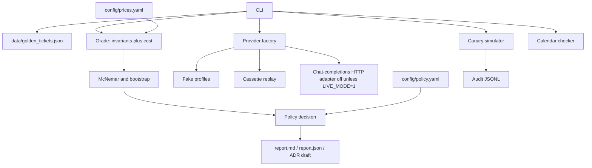

# Architecture

The harness is a library under `src/migration_eval` plus YAML config and a JSON golden set. A command builds two providers, grades every ticket, and writes a report. Nothing in the default path opens a socket to a model host.

## Modules

| Module | Role |
| --- | --- |
| `golden.py` | Builds and loads the 63 synthetic tickets |
| `spec.py` | Priority and queue rules |
| `invariants.py` | Effect checks |
| `providers/fake.py` | Scripted behaviours, including the degraded profile |
| `providers/cassette.py` | Record or replay. Replay never calls the network |
| `providers/openai_compat.py` | Optional chat-completions HTTP adapter. Raises before any request when `LIVE_MODE` is off or config is missing. Writes cassettes under `var/` on `compare-live` |
| `compare.py` | Paired runs. Seed repeats collapse to one pass/fail per ticket |
| `stats.py` | Exact one-sided McNemar and a bootstrap over tickets |
| `policy.py` | GO, NO_GO, NEED_HUMAN |
| `canary.py` | Stratified synthetic split and rollback decision |
| `deprecation.py` | Calendar versus an injected date |
| `evalkit/` | Re-export of the invariant and trace surface. See docs/PROVENANCE.md |
| `retries.py` | Max attempts and a capped backoff, used by the live adapter |
| `logging_setup.py` | JSON logs |
| `secretscan.py` | Coarse secret scan |
| `trace.py` | JSONL append |

## Prompt boundary

`render_user_prompt` sends subject and body only. `true_category`, severity flags, and `variant` stay off the prompt. Fake providers are allowed to read `variant` because they are simulators. That split is covered by a test.

## What a completion is

A completion carries raw text, a parsed triage object or nothing, simulated or measured token counts, latency, and how many attempts it took. Cost is applied afterwards from the price table. The grader does not trust the provider's own "I passed" bit. There isn't one.
